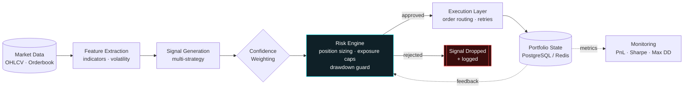
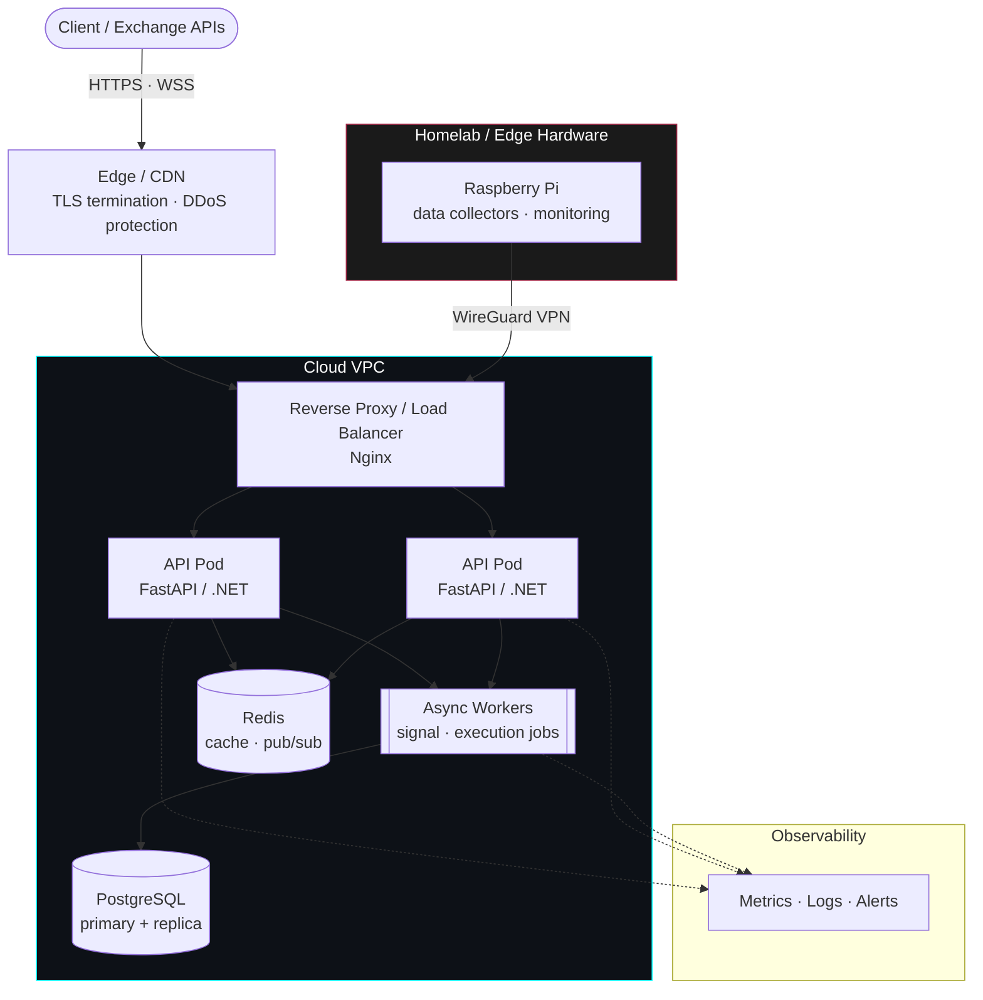

<!-- ═══════════════════════════ HEADER ═══════════════════════════ -->
<p align="center">
  
</p>

<p align="center">
  
</p>

<p align="center">
  
  
  
  
</p>

---

## `$ whoami`

```python
from dataclasses import dataclass, field

@dataclass(frozen=True)
class Engineer:
    name: str = "Efe Taşkıran"
    role: str = "Backend Engineer · Computer Engineering Student"
    focus: tuple = (
        "Algorithmic trading engines",
        "Financial data pipelines",
        "Domain-Driven backend architecture",
        "Distributed & fault-tolerant systems",
        "Cloud infrastructure & networking",
        "Hardware-aware performance (CPU, memory, I/O)",
    )
    stack_depth: dict = field(default_factory=lambda: {
        "application": ["FastAPI", ".NET", "ABP"],
        "data":        ["PostgreSQL", "Redis"],
        "platform":    ["Docker", "Kubernetes", "Linux"],
        "network":     ["TCP/IP", "WebSockets", "Nginx", "TLS"],
        "metal":       ["C", "Raspberry Pi", "Computer Architecture"],
    })
    principles: tuple = (
        "Real systems > demo projects",
        "Risk-adjusted returns > raw prediction accuracy",
        "Explicit state, idempotent operations, observable everything",
    )
    currently: str = "Hardening execution & risk layers for production-grade trading infra"

me = Engineer()
```

---

## ⚙️ Tech Stack

<table>
  <tr>
    <td><b>Backend</b></td>
    <td>
      
      
      
      
      
    </td>
  </tr>
  <tr>
    <td><b>Data / ML</b></td>
    <td>
      
      
      
      
    </td>
  </tr>
  <tr>
    <td><b>Storage</b></td>
    <td>
      
      
      
    </td>
  </tr>
  <tr>
    <td><b>Infra / DevOps</b></td>
    <td>
      
      
      
      
    </td>
  </tr>
  <!-- ☁️ Cloud / Network / Hardware: keep only what you've actually used -->
  <tr>
    <td><b>Cloud</b></td>
    <td>
      
      
      
      
      
    </td>
  </tr>
  <tr>
    <td><b>Networking</b></td>
    <td>
      
      
      
      
      
      
    </td>
  </tr>
  <tr>
    <td><b>Hardware / Low-Level</b></td>
    <td>
      
      
      
      
      
    </td>
  </tr>
  <tr>
    <td><b>Architecture</b></td>
    <td>
      
      
      
      
    </td>
  </tr>
</table>

---

## 🧠 Trading Engine Architecture



> **Design rule:** every signal must pass the risk engine. Execution never talks to the market without an approved, size-bounded order.

---

## ☁️ Infrastructure & Network Topology

How the systems are deployed: from the edge down to the hardware.



<table>
  <tr>
    <th>☁️ Cloud</th>
    <th>🌐 Network</th>
    <th>🔩 Hardware</th>
  </tr>
  <tr valign="top">
    <td>
      • Containerized services (Docker → Kubernetes)<br/>
      • Infrastructure as Code with Terraform<br/>
      • Managed databases, secrets & private VPCs<br/>
      • CI/CD with GitHub Actions
    </td>
    <td>
      • Low-latency WebSocket market feeds<br/>
      • Reverse proxy, TLS, rate limiting<br/>
      • DNS, firewall rules, network segmentation<br/>
      • Site-to-site VPN with WireGuard
    </td>
    <td>
      • CPU cache & memory-layout aware code<br/>
      • I/O bottleneck profiling<br/>
      • Raspberry Pi edge nodes & homelab<br/>
      • Embedded C / Arduino prototypes
    </td>
  </tr>
</table>

---

## 🚀 Featured Projects

### 📈 Crypto Trading Engine
   

FastAPI-based algorithmic trading system built around **risk-adjusted decision making**, not raw price prediction.

| Layer | What it does |
|---|---|
| **Indicator pipeline** | Composable technical-indicator features over streaming market data |
| **Confidence-weighted signals** | Each strategy emits a signal + confidence score; scores are aggregated before acting |
| **Volatility-aware sizing** | Position size scales inversely with realized volatility |
| **Automated execution** | Order placement with state tracking and failure handling |
| **Portfolio state logging** | Every decision and fill persisted for audit and post-trade analysis |

➡️ [`Browse repositories`](https://github.com/Tsknefe?tab=repositories)

---

### 🏦 BankApiABP
   

Production-style banking backend built with **ABP Framework** and **Domain-Driven Design**.

- **Modular domain services** with clear aggregate boundaries
- **Transaction management** with consistency guarantees across operations
- **Concurrency handling** to prevent race conditions on balance updates
- **Permission system** with role-based authorization
- **Structured logging** for traceability

➡️ [`View repository`](https://github.com/Tsknefe/BankApiABP)

---

### 🧵 String Art Generator
 

Computer-vision pipeline that converts an input image into **step-by-step string-art instructions** (nail sequence) using image processing and a greedy line-selection approach.

➡️ [`Browse repositories`](https://github.com/Tsknefe?tab=repositories)

---

## 🛠️ Engineering Principles

<details>
<summary><b>Click to expand</b></summary>
<br/>

- **Capital preservation first** — a missed trade is cheaper than a bad one.
- **Explicit state** — portfolio and order state are persisted, never inferred.
- **Idempotency** — retries must never double-execute an order or a transaction.
- **Fail loudly** — structured logs and clear error paths over silent fallbacks.
- **Boundaries matter** — domain logic stays independent of frameworks and I/O.

</details>

---

## 📊 GitHub Stats

<p align="center">
  
  
</p>

<p align="center">
  
</p>

<p align="center">
  
</p>

---

## 📡 Connect

<p align="center">
  <a href="https://github.com/Tsknefe"></a>
  <!-- 🔗 Replace with your LinkedIn profile URL -->
  <a href="https://www.linkedin.com/in/efe-ta%C5%9Fk%C4%B1ran-9378ba25b/"></a>
  <!-- 🔗 Replace with your email -->
  <a href="mailto:taskiranefe5@gmail.com"></a>
</p>

<p align="center">
  
</p>
